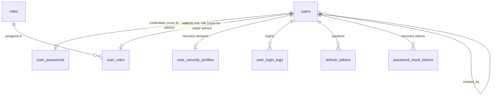

# Schema
```sql
-- =====================================================================
-- node_backend_baseline : MySQL schema
-- Requires MySQL 8.0.16+ (expression defaults, enforced CHECK constraints).
-- MySQL 8.4 LTS is recommended.
--
-- Conventions
--   * All timestamps are DATETIME(6) and are stored in UTC.
--   * Soft delete only (is_deleted); rows are never physically removed
--     by the application (except expired tokens, by the cleanup job).
--   * created_by / updated_by reference users(user_id).
--       - user_id = 1 is the reserved SUPER ADMIN row (see README).
--       - created_by = NULL on a user row means "self-registered".
--
-- Change vs. the original design: user_passwords.must_change_password
-- was added (forced password change after an admin-created account or an
-- admin password reset).
-- =====================================================================
CREATE DATABASE IF NOT EXISTS node_backend_baseline
  CHARACTER SET utf8mb4
  COLLATE utf8mb4_0900_as_ci;

USE node_backend_baseline;

-- ---------------------------------------------------------------------
-- users
-- email_active / sso_id_active are NULL for soft-deleted rows, so the
-- UNIQUE indexes on them only apply among non-deleted users: a deleted
-- account keeps its email/sso_id on its own row (history intact) but
-- the value is immediately free for a new account to use.
-- ---------------------------------------------------------------------
CREATE TABLE users (
  user_id BIGINT AUTO_INCREMENT PRIMARY KEY,
  sso_id VARCHAR(100),
  full_name VARCHAR(100) NOT NULL,
  email VARCHAR(150) NOT NULL,
  last_login DATETIME(6) NULL,
  is_active BOOLEAN NOT NULL DEFAULT TRUE,
  is_deleted BOOLEAN NOT NULL DEFAULT FALSE,
  created_by BIGINT NULL,
  created_at DATETIME(6) NOT NULL DEFAULT (UTC_TIMESTAMP(6)),
  email_active VARCHAR(150)
    GENERATED ALWAYS AS (IF(is_deleted = FALSE, email, NULL)) STORED,
  sso_id_active VARCHAR(100)
    GENERATED ALWAYS AS (IF(is_deleted = FALSE, sso_id, NULL)) STORED,
  CONSTRAINT uq_users_email_active UNIQUE (email_active),
  CONSTRAINT uq_users_sso_id_active UNIQUE (sso_id_active),
  CONSTRAINT fk_users_created_by FOREIGN KEY (created_by) REFERENCES users(user_id)
) ENGINE=InnoDB DEFAULT CHARSET=utf8mb4 COLLATE=utf8mb4_0900_as_ci;

CREATE INDEX idx_users_email ON users(email);
CREATE INDEX idx_users_active ON users(is_active);
CREATE INDEX idx_users_deleted ON users(is_deleted);

-- ---------------------------------------------------------------------
-- user_passwords (one row per user, overwritten in place on change)
-- updated_at doubles as "password last changed at": access tokens issued
-- before it are rejected (see README, "Access token invalidation").
-- The super admin has NO row here: its credentials live in ENV only.
-- ---------------------------------------------------------------------
CREATE TABLE user_passwords (
  user_password_id BIGINT AUTO_INCREMENT PRIMARY KEY,
  user_id BIGINT NOT NULL UNIQUE,
  hash_password VARCHAR(255) NOT NULL,
  must_change_password BOOLEAN NOT NULL DEFAULT FALSE,
  created_by BIGINT NULL,
  created_at DATETIME(6) NOT NULL DEFAULT (UTC_TIMESTAMP(6)),
  updated_by BIGINT NULL,
  updated_at DATETIME(6) NULL DEFAULT (UTC_TIMESTAMP(6)),
  CONSTRAINT fk_user_password_user FOREIGN KEY (user_id) REFERENCES users(user_id) ON DELETE CASCADE,
  CONSTRAINT fk_user_password_creator FOREIGN KEY (created_by) REFERENCES users(user_id),
  CONSTRAINT fk_user_password_updater FOREIGN KEY (updated_by) REFERENCES users(user_id)
) ENGINE=InnoDB DEFAULT CHARSET=utf8mb4 COLLATE=utf8mb4_0900_as_ci;

-- ---------------------------------------------------------------------
-- roles
-- Only the assignable roles live here (member, admin). "super_admin" is
-- intentionally NOT a row: it can never be assigned to anyone.
-- ---------------------------------------------------------------------
CREATE TABLE roles (
  role_id BIGINT AUTO_INCREMENT PRIMARY KEY,
  role_name VARCHAR(100) NOT NULL UNIQUE,
  role_level INT NULL,
  description TEXT,
  is_active BOOLEAN NOT NULL DEFAULT TRUE,
  is_deleted BOOLEAN NOT NULL DEFAULT FALSE,
  created_by BIGINT NOT NULL,
  created_at DATETIME(6) NOT NULL DEFAULT (UTC_TIMESTAMP(6)),
  updated_by BIGINT NULL,
  updated_at DATETIME(6) NULL DEFAULT (UTC_TIMESTAMP(6)),
  CONSTRAINT fk_roles_created_by FOREIGN KEY (created_by) REFERENCES users(user_id),
  CONSTRAINT fk_roles_updated_by FOREIGN KEY (updated_by) REFERENCES users(user_id)
) ENGINE=InnoDB DEFAULT CHARSET=utf8mb4 COLLATE=utf8mb4_0900_as_ci;

-- ---------------------------------------------------------------------
-- user_roles (one active role per user)
-- A role change is always an UPDATE of the single row (user_id is UNIQUE).
-- The super admin has NO row here.
-- ---------------------------------------------------------------------
CREATE TABLE user_roles (
  user_roles_id BIGINT AUTO_INCREMENT PRIMARY KEY,
  user_id BIGINT NOT NULL UNIQUE,
  role_id BIGINT NOT NULL,
  is_active BOOLEAN NOT NULL DEFAULT TRUE,
  is_deleted BOOLEAN NOT NULL DEFAULT FALSE,
  assigned_at DATETIME(6) NOT NULL DEFAULT (UTC_TIMESTAMP(6)),
  created_by BIGINT NULL,
  created_at DATETIME(6) NOT NULL DEFAULT (UTC_TIMESTAMP(6)),
  updated_by BIGINT NULL,
  updated_at DATETIME(6) NULL DEFAULT (UTC_TIMESTAMP(6)),
  CONSTRAINT fk_user_roles_user FOREIGN KEY (user_id) REFERENCES users(user_id) ON DELETE CASCADE,
  CONSTRAINT fk_user_roles_role FOREIGN KEY (role_id) REFERENCES roles(role_id),
  CONSTRAINT fk_user_roles_created_by FOREIGN KEY (created_by) REFERENCES users(user_id),
  CONSTRAINT fk_user_roles_updated_by FOREIGN KEY (updated_by) REFERENCES users(user_id)
) ENGINE=InnoDB DEFAULT CHARSET=utf8mb4 COLLATE=utf8mb4_0900_as_ci;

CREATE INDEX idx_user_roles_role ON user_roles(role_id);

-- ---------------------------------------------------------------------
-- user_login_logs
-- ---------------------------------------------------------------------
CREATE TABLE user_login_logs (
  user_login_logs_id BIGINT AUTO_INCREMENT PRIMARY KEY,
  user_id BIGINT NOT NULL,
  login_time DATETIME(6) NOT NULL DEFAULT (UTC_TIMESTAMP(6)),
  login_status ENUM('SUCCESS','FAILURE') NOT NULL DEFAULT 'SUCCESS',
  failure_reason TEXT,
  ip_address VARCHAR(45),
  created_by BIGINT NULL,
  created_at DATETIME(6) NOT NULL DEFAULT (UTC_TIMESTAMP(6)),
  CONSTRAINT fk_login_logs_user FOREIGN KEY (user_id) REFERENCES users(user_id) ON DELETE CASCADE,
  CONSTRAINT fk_login_logs_created_by FOREIGN KEY (created_by) REFERENCES users(user_id)
) ENGINE=InnoDB DEFAULT CHARSET=utf8mb4 COLLATE=utf8mb4_0900_as_ci;

CREATE INDEX idx_login_logs_user ON user_login_logs(user_id);
CREATE INDEX idx_login_logs_login_time ON user_login_logs(login_time);

-- ---------------------------------------------------------------------
-- refresh_tokens (opaque, stored only as a SHA-256 hex digest)
-- Rotation: the used token gets revoked_at + replaced_by_hash, a new row
-- is inserted. Presenting an already-rotated token again = reuse
-- (theft signal) -> every active token of that user is revoked.
-- ---------------------------------------------------------------------
CREATE TABLE refresh_tokens (
  refresh_tokens_id BIGINT AUTO_INCREMENT PRIMARY KEY,
  user_id BIGINT NOT NULL,
  token_hash CHAR(64) CHARACTER SET ascii COLLATE ascii_bin NOT NULL UNIQUE,
  expires_at DATETIME(6) NOT NULL,
  revoked_at DATETIME(6) NULL,
  replaced_by_hash CHAR(64) CHARACTER SET ascii COLLATE ascii_bin NULL,
  user_agent TEXT NULL,
  created_at DATETIME(6) NOT NULL DEFAULT (UTC_TIMESTAMP(6)),
  updated_at DATETIME(6) NOT NULL DEFAULT (UTC_TIMESTAMP(6)),
  CONSTRAINT fk_refresh_tokens_user FOREIGN KEY (user_id) REFERENCES users(user_id) ON DELETE CASCADE
) ENGINE=InnoDB DEFAULT CHARSET=utf8mb4 COLLATE=utf8mb4_0900_as_ci;

CREATE INDEX idx_refresh_tokens_user_id ON refresh_tokens(user_id);
CREATE INDEX idx_refresh_tokens_expires_at ON refresh_tokens(expires_at);

-- ---------------------------------------------------------------------
-- user_security_profiles - answers used to recover a forgotten password
-- (no email involved). One row per user.
--
-- Questions 1-3 are fixed for everyone (date of birth + two questions
-- defined in the application), so only their bcrypt-hashed answers are
-- stored. Questions 4-5 are optional and written by the user, so their
-- text is stored too. Answers are normalised (trimmed, case-folded, DOB as
-- an ISO date) BEFORE hashing, and never stored or logged in plain text.
-- (The application additionally applies an HMAC "pepper" from ENV before
-- bcrypt, so a leaked database alone cannot be brute-forced offline.)
--
-- failed_attempts / locked_until implement the per-account lockout: after
-- 5 wrong verification attempts the account is locked for 15 minutes.
-- ---------------------------------------------------------------------
CREATE TABLE user_security_profiles (
  user_id BIGINT PRIMARY KEY,
  dob_hash VARCHAR(255) NOT NULL,
  answer_q2_hash VARCHAR(255) NOT NULL,
  answer_q3_hash VARCHAR(255) NOT NULL,
  custom_question_1 VARCHAR(200) NULL,
  custom_answer_1_hash VARCHAR(255) NULL,
  custom_question_2 VARCHAR(200) NULL,
  custom_answer_2_hash VARCHAR(255) NULL,
  failed_attempts INT NOT NULL DEFAULT 0,
  locked_until DATETIME(6) NULL,
  created_at DATETIME(6) NOT NULL DEFAULT (UTC_TIMESTAMP(6)),
  updated_at DATETIME(6) NOT NULL DEFAULT (UTC_TIMESTAMP(6)),
  CONSTRAINT fk_security_profiles_user FOREIGN KEY (user_id) REFERENCES users(user_id) ON DELETE CASCADE,
  -- a custom question and its answer exist together, or not at all
  CONSTRAINT chk_custom_1_pair CHECK ((custom_question_1 IS NULL) = (custom_answer_1_hash IS NULL)),
  CONSTRAINT chk_custom_2_pair CHECK ((custom_question_2 IS NULL) = (custom_answer_2_hash IS NULL))
) ENGINE=InnoDB DEFAULT CHARSET=utf8mb4 COLLATE=utf8mb4_0900_as_ci;

-- ---------------------------------------------------------------------
-- password_reset_tokens - issued only after every security answer was
-- correct. Short-lived (10 min), single-use, stored only as a SHA-256 hex
-- digest, exactly like refresh tokens.
-- ---------------------------------------------------------------------
CREATE TABLE password_reset_tokens (
  password_reset_tokens_id BIGINT AUTO_INCREMENT PRIMARY KEY,
  user_id BIGINT NOT NULL,
  token_hash CHAR(64) CHARACTER SET ascii COLLATE ascii_bin NOT NULL UNIQUE,
  expires_at DATETIME(6) NOT NULL,
  used_at DATETIME(6) NULL,
  requested_ip VARCHAR(45) NULL,
  created_at DATETIME(6) NOT NULL DEFAULT (UTC_TIMESTAMP(6)),
  CONSTRAINT fk_password_reset_tokens_user FOREIGN KEY (user_id) REFERENCES users(user_id) ON DELETE CASCADE
) ENGINE=InnoDB DEFAULT CHARSET=utf8mb4 COLLATE=utf8mb4_0900_as_ci;

CREATE INDEX idx_password_reset_tokens_user ON password_reset_tokens(user_id);
CREATE INDEX idx_password_reset_tokens_expires ON password_reset_tokens(expires_at);

```

# Seed
```sql
-- =====================================================================
-- Required seed data (safe for every environment, idempotent)
--
--   1. user_id = 1  -> the reserved SUPER ADMIN row.
--      The name/email below are placeholders: on every start the
--      application overwrites them from SUPER_ADMIN_NAME / SUPER_ADMIN_EMAIL.
--      This row has NO password row, NO role row and NO security profile -
--      the password lives only in ENV (SUPER_ADMIN_PASSWORD_HASH).
--   2. roles        -> member (level 1), admin (level 2).
--      There is deliberately no "super_admin" role.
--
-- Demo accounts live in seed.demo.sql (development only).
-- =====================================================================
USE node_backend_baseline;

INSERT INTO users (user_id, full_name, email, is_active, created_by)
VALUES (1, 'Super Admin', 'super.admin@example.com', TRUE, NULL)
ON DUPLICATE KEY UPDATE user_id = user_id;

INSERT INTO roles (role_id, role_name, role_level, description, created_by) VALUES
  (1, 'member', 1, 'Default role for every self-registered user. Can manage only their own account.', 1),
  (2, 'admin',  2, 'Manages users (create, update, activate/deactivate, delete members, promote members to admin).', 1)
ON DUPLICATE KEY UPDATE description = VALUES(description), role_level = VALUES(role_level);

```

# Seed Demo
```sql
-- =====================================================================
-- DEMO DATA - DEVELOPMENT ONLY. NEVER load this file in production:
-- the passwords below are public (they are written in the README).
--
--   demo.admin@example.com   /  Admin@12345    (role: admin)
--   demo.member@example.com  /  Member@12345   (role: member)
--
-- Both accounts are "created by" the super admin (user_id = 1).
-- Requires seed.sql to have been loaded first. Idempotent.
-- =====================================================================
USE node_backend_baseline;

INSERT INTO users (user_id, full_name, email, is_active, created_by) VALUES
  (2, 'Demo Admin',  'demo.admin@example.com',  TRUE, 1),
  (3, 'Demo Member', 'demo.member@example.com', TRUE, 1)
ON DUPLICATE KEY UPDATE user_id = user_id;

INSERT INTO user_passwords (user_id, hash_password, must_change_password, created_by) VALUES
  (2, '$2b$12$9eYNyLaVRgdBqPKljk2mruEhMDjI3ifFOWRXkLTqbyc.2R1OJ9Y3C', FALSE, 1),
  (3, '$2b$12$jyZTDzbG03ee9DzXcs6SQeEVJNCqgzRVXoG9K.wN/JSENtYS8/6qm', FALSE, 1)
ON DUPLICATE KEY UPDATE user_id = user_id;

INSERT INTO user_roles (user_id, role_id, created_by)
SELECT 2, role_id, 1 FROM roles WHERE role_name = 'admin'
ON DUPLICATE KEY UPDATE user_id = user_id;

INSERT INTO user_roles (user_id, role_id, created_by)
SELECT 3, role_id, 1 FROM roles WHERE role_name = 'member'
ON DUPLICATE KEY UPDATE user_id = user_id;

```

# Readme

# Node Backend Baseline

An enterprise-grade **Express.js + MySQL** backend baseline. No ORM: every query is real, hand-written, parameterised SQL that lives in the module's service file. It ships with role-based access control (Super Admin / Admin / Member), JWT access tokens with rotating refresh tokens, security-question password recovery (no e-mail service), a standard API response, custom exceptions, a request context store, structured logging, rate limiting and a full automated test suite.

> **ES modules.** The project is pure ESM (`"type": "module"` in `package.json`): `import` / `export` everywhere, and relative imports always carry the `.js` extension.

This README is the single source of truth for what was **discussed and decided**. If you change a rule, change it here too.

---

## Table of contents

1. [Overview](#1-overview)
2. [Quick start](#2-quick-start)
3. [Project structure](#3-project-structure)
4. [Architecture](#4-architecture)
5. [Roles and authorization (RBAC)](#5-roles-and-authorization-rbac)
6. [Database](#6-database)
7. [Data access layer and transactions](#7-data-access-layer-and-transactions)
8. [Authentication and sessions](#8-authentication-and-sessions)
9. [Password recovery (security questions)](#9-password-recovery-security-questions)
10. [Standard API response and error handling](#10-standard-api-response-and-error-handling)
11. [API reference](#11-api-reference)
12. [Cross-cutting concepts](#12-cross-cutting-concepts) (context store, logger, middlewares, rate limiting, security)
13. [Configuration reference](#13-configuration-reference)
14. [Rules we follow](#14-rules-we-follow)
15. [Decisions log](#15-decisions-log)
16. [Testing](#16-testing)
17. [Deployment and production checklist](#17-deployment-and-production-checklist)
18. [Frontend integration notes](#18-frontend-integration-notes)
19. [Troubleshooting](#19-troubleshooting)
20. [Known limitations and future extensions](#20-known-limitations-and-future-extensions)

---

## 1. Overview

### What is implemented

| Concept | Where it lives |
| --- | --- |
| API design: **Router, Schema, Service** per module | `src/modules/*` |
| Raw SQL helpers (`queryOne`, `queryAll`, `fetchOne`, `fetchAll`, `queryScalar`, `execute`) | `src/database/` |
| Transactions for every multi-table write | `src/database/transaction.js` |
| **Request Context Store** (AsyncLocalStorage) | `src/context/requestContext.js` |
| **Refresh token** (opaque, hashed, rotated, reuse detection, httpOnly cookie) | `src/modules/auth/token.service.js`, `auth.cookies.js` |
| **Authentication** (JWT + per-request DB re-check) | `src/middlewares/authenticate.middleware.js` |
| **Authorization / RBAC** (route level + instance level) | `authorize.middleware.js`, `src/modules/admin/admin.policy.js` |
| **Middlewares** | `src/middlewares/` |
| **Standard API response** (only success and failure) | `src/utils/response.js` |
| **Custom exception classes** with correct status codes | `src/errors/` |
| **Logger** (pino, structured, redacting, request-aware) | `src/utils/logger.js` |
| Validated configuration | `src/config/` |
| Security-question password recovery with lockout | `src/modules/auth/recovery.service.js` |
| Tests: unit + integration against a real MySQL | `tests/` |

### Tech stack

| Area | Choice |
| --- | --- |
| Runtime | Node.js **22+** (ESM) |
| HTTP | Express **5** (rejected promises reach the error handler natively, no `asyncHandler` needed) |
| Database | MySQL **8.0.16+** (8.4 LTS recommended) through `mysql2` (promise pool, prepared statements) |
| Validation | `zod` 4 |
| Auth | `jsonwebtoken` (HS256 access token), `bcrypt` (passwords and security answers) |
| Logging | `pino` (+ `pino-pretty` in development) |
| Hardening | `helmet`, `cors`, `express-rate-limit`, `compression`, `cookie-parser` |
| Tests | `node:test` + `supertest` |
| Quality | ESLint 10 (flat config) + Prettier, GitHub Actions CI |

---

## 2. Quick start

### Prerequisites

- Node.js 22 or newer (`.nvmrc` is provided)
- A MySQL 8 server and an account that may `CREATE DATABASE` (used only by the `db:*` scripts)

### Steps

```bash
# 1. Install
npm install

# 2. Configure
cp .env.example .env
#    Quick local start: set DB_USER=root and DB_PASSWORD=<your root password>.
#    Cleaner setup:     keep a least-privilege runtime user in DB_USER / DB_PASSWORD (see below) and
#                       put an account that may CREATE DATABASE in DB_ADMIN_USER / DB_ADMIN_PASSWORD;
#                       only the db:* scripts use the admin account.
#    Then generate real secrets, see "Generating secrets" below.

# 3. Create the database (schema + required seed + demo users)
npm run db:setup:demo        # development
# npm run db:setup           # production-safe: schema + seed only, NO demo users

# 4. Run
npm run dev                  # watch mode + pretty logs
npm start                    # plain
```

The API is now on `http://localhost:3000/api/v1` (probes on `/health`).

### Demo accounts (development only, `seed.demo.sql`)

| Role | E-mail | Password |
| --- | --- | --- |
| Super admin | value of `SUPER_ADMIN_EMAIL` (`superadmin@example.com` in `.env.example`) | `SuperAdmin@12345` (the hash in `.env.example`) |
| Admin | `demo.admin@example.com` | `Admin@12345` |
| Member | `demo.member@example.com` | `Member@12345` |

These passwords are public. `seed.demo.sql` must never be loaded in production (the `db:*` scripts refuse to, when `NODE_ENV=production`).

### Generating secrets

```bash
# JWT_ACCESS_SECRET and SECURITY_ANSWER_PEPPER (run twice, use two different values)
node -e "console.log(require('crypto').randomBytes(64).toString('hex'))"

# SUPER_ADMIN_PASSWORD_HASH (prompts for the password, input hidden)
npm run hash-password
```

Keep the single quotes around the hash in `.env` (`SUPER_ADMIN_PASSWORD_HASH='$2b$12$...'`): it contains `$` characters.

### Create the runtime database user (recommended)

The application itself never needs DDL rights:

```sql
CREATE USER 'app_user'@'%' IDENTIFIED BY 'a-strong-password';
GRANT SELECT, INSERT, UPDATE, DELETE ON node_backend_baseline.* TO 'app_user'@'%';
```

### Docker alternative

```bash
cp .env.example .env
docker compose up --build        # MySQL 8.4 (schema + seed + demo auto-loaded) + the API
```

`docker-compose.yml` is a **development** stack. See [section 17](#17-deployment-and-production-checklist) for production.

### Try it (curl)

```bash
B=http://localhost:3000/api/v1

# log in (the refresh token is stored in the cookie jar, never in the body)
curl -s -c jar.txt -H 'Content-Type: application/json' \
     -d '{"email":"demo.admin@example.com","password":"Admin@12345"}' $B/auth/login

# call a protected route with the access token from the response
curl -s -H "Authorization: Bearer <accessToken>" "$B/admin/users?limit=5"

# rotate the refresh token (cookie only, no body)
curl -s -b jar.txt -c jar.txt -X POST $B/auth/refresh
```

### npm scripts

| Script | What it does |
| --- | --- |
| `npm start` / `npm run dev` | Run the API / run with `node --watch` |
| `npm run db:schema` | Create the database and all tables |
| `npm run db:seed` | Required data: super-admin row + roles (idempotent) |
| `npm run db:seed:demo` | Demo users (development only) |
| `npm run db:setup` | schema + seed |
| `npm run db:setup:demo` | schema + seed + demo users |
| `npm run db:reset` | **DROP** the database, then `setup:demo` (refuses in production) |
| `npm run hash-password` | Generate `SUPER_ADMIN_PASSWORD_HASH` |
| `npm run lint` / `lint:fix` | ESLint |
| `npm run format` / `format:check` | Prettier |
| `npm test` | Unit + integration tests |
| `npm run test:unit` / `test:integration` | One suite only |

If `DB_NAME` is not `node_backend_baseline`, the `db:*` scripts substitute the name automatically; no SQL file needs editing.

---

## 3. Project structure

```
.
├── database/
│   └── mysql/
│       ├── schema.sql            all tables (the agreed schema + must_change_password)
│       ├── seed.sql              REQUIRED data: super-admin row (id 1) + roles member/admin
│       └── seed.demo.sql         DEMO users, development only
├── scripts/
│   ├── db.js                     CLI behind the db:* npm scripts
│   ├── hash-password.js          generates SUPER_ADMIN_PASSWORD_HASH
│   └── lib/dbTasks.js            runs the .sql files (also used by the tests)
├── src/
│   ├── server.js                 bootstrap: verify DB -> sync super admin -> listen -> graceful shutdown
│   ├── app.js                    Express app factory (middleware order lives here)
│   ├── config/                   env.js (zod validation + production guards), index.js (frozen config)
│   ├── constants/                roles, error codes, security questions
│   ├── context/                  requestContext.js (AsyncLocalStorage)
│   ├── errors/                   AppError + one class per HTTP status
│   ├── database/                 pool, executor (query helpers), transaction, MySQL error mapping
│   ├── middlewares/              requestContext, requestLogger, cors, validate, authenticate,
│   │                             authorize, rateLimiter, notFound, errorHandler
│   ├── utils/                    logger, response, crypto, password, validation (zod blocks),
│   │                             pagination, sql, mask, userMapper
│   ├── bootstrap/                startup tasks: verifyDatabase.js, superAdmin.js
│   ├── jobs/                     cleanup.job.js (purges long-expired tokens)
│   └── modules/                  one folder per feature; each has AT LEAST router + schema + service
│       ├── index.js              the only place that mounts modules
│       ├── auth/                 auth.router/.schema/.service + token.service, recovery.service,
│       │                         securityAnswers, auth.cookies
│       ├── users/                self-service (/users/me)
│       ├── admin/                user management + admin.policy.js (who may act on whom)
│       ├── roles/                read-only list of assignable roles
│       └── health/               liveness / readiness probes
├── tests/
│   ├── setup.js                  hermetic test environment (loaded with --import)
│   ├── helpers/                  app/db helpers, rate-limit probe
│   ├── unit/                     no database needed
│   └── integration/              real MySQL (a dedicated test database)
├── Dockerfile  docker-compose.yml  .github/workflows/ci.yml
├── .env.example  .env.test.example
└── eslint.config.js  .prettierrc.json  .editorconfig  .nvmrc
```

### The module contract

Every folder in `src/modules/` contains at least:

| File | Responsibility | May contain | Must NOT contain |
| --- | --- | --- | --- |
| `<name>.router.js` | HTTP only | route paths, rate limiters, `authenticate`/`authorize`, `validate(schema)`, a thin handler that calls the service and `sendSuccess` | business rules, SQL |
| `<name>.schema.js` | Request validation | zod schemas shaped `{ body?, query?, params? }` | logic, I/O |
| `<name>.service.js` | Business rules + SQL | queries (`db` / `withTransaction`), authorization decisions, throwing custom exceptions | `req`/`res`, status codes, response formatting |

Extra files are fine when a module grows (`auth` has `token.service.js`, `recovery.service.js`, ...). Dependencies only point one way: `admin` → `users` → `auth/token.service`, and `auth.service` → `users.service`. There are no import cycles.

### Adding a new module

```js
// src/modules/projects/projects.schema.js
import { z, paginationQuerySchema } from '../../utils/validation.js';
export const createProjectSchema = {
  body: z.strictObject({ name: z.string().trim().min(2).max(100) }),
};
export const listProjectsSchema = { query: paginationQuerySchema };

// src/modules/projects/projects.service.js
import { db } from '../../database/index.js';
export async function createProject(actor, { name }) {
  const { insertId } = await db.execute(
    'INSERT INTO projects (name, created_by, created_at) VALUES (?, ?, ?)',
    [name, actor.userId, new Date()],
  );
  return { projectId: insertId, name };
}

// src/modules/projects/projects.router.js
import { Router } from 'express';
import { ROLES } from '../../constants/roles.js';
import { authenticate } from '../../middlewares/authenticate.middleware.js';
import { authorize } from '../../middlewares/authorize.middleware.js';
import { validate } from '../../middlewares/validate.middleware.js';
import { sendCreated } from '../../utils/response.js';
import { createProjectSchema } from './projects.schema.js';
import * as projectsService from './projects.service.js';

const router = Router();
router.post(
  '/',
  authenticate(),
  authorize(ROLES.MEMBER),
  validate(createProjectSchema),
  async (req, res) => {
    const project = await projectsService.createProject(req.user, req.validated.body);
    sendCreated(res, { message: 'Project created successfully', data: project });
  },
);
export default router;

// src/modules/index.js  ->  api.use('/projects', projectsRouter);
```

Throwing inside a handler or service is enough; Express 5 forwards it to the global error handler.

---

## 4. Architecture

### Request lifecycle

```
HTTP request
   │
   ▼  app.js (global, in this order)
requestContext → requestLogger → helmet → CORS → compression → no-store → JSON + cookie parsers → global rate limit
   │
   ▼  module router
route rate limiter(s)      auth / login / recovery limiters
authenticate()             verify JWT → re-read user from DB → check account state → req.user
authorize(...roles)        route-level RBAC   (denySuperAdmin for self-service credential routes)
validate(schema)           zod → req.validated.{params,query,body}   (422 on failure)
handler                    reads ONLY req.validated, calls the service, sends sendSuccess()
   │
   ▼  service
authorization of the specific target (admin.policy)  →  SQL via db / withTransaction  →  returns data

Anything thrown, anywhere ─────────────► errorHandler ─► standard failure response
```

### Layering rules

1. **Router** turns HTTP into a service call and the result into a response. It never contains business rules or SQL.
2. **Schema** describes the shape of valid input. Unknown fields are rejected on bodies (`z.strictObject`), so nobody can mass-assign `role` or `isActive`.
3. **Service** owns the rules and the SQL. It receives plain values (`actor`, validated input) and returns plain data. It throws custom exceptions and knows nothing about HTTP.
4. **The error handler is the only place** that converts an exception into an HTTP response.

---

## 5. Roles and authorization (RBAC)

### Roles

| Role | Level | Stored in | Purpose |
| --- | --- | --- | --- |
| `super_admin` | 1000 (in code) | `users` row **`user_id = 1`** only; **not** in `roles` | Top role, no restrictions, exactly one, credentials in ENV only |
| `admin` | 2 (`roles.role_level`) | `roles` + `user_roles` | User management |
| `member` | 1 (`roles.role_level`) | `roles` + `user_roles` | Default role of every sign-up |

### The super admin design

The super admin is a **reserved row, `users.user_id = 1`**, because `roles.created_by`, login logs and refresh tokens all have foreign keys to `users`. A purely virtual account would break them and lose the audit trail.

- The row holds only name and e-mail. At **every startup** they are synced from `SUPER_ADMIN_NAME` / `SUPER_ADMIN_EMAIL` (the row is also created, revived and re-activated if needed).
- It has **no** `user_passwords`, **no** `user_roles` and **no** security-profile row. The startup check refuses to run if someone wrote such rows for id 1.
- The password lives **only in ENV**, as a bcrypt hash (`SUPER_ADMIN_PASSWORD_HASH`), never as plain text. Login compares against it with bcrypt (constant time).
- "Only one super admin" is enforced structurally: there is no `super_admin` row in `roles`, so it can never be assigned through the API, and a second super admin cannot exist.
- Nobody can register with its e-mail (unique index).
- The super admin account is **managed by ENV, not by the API**. Change password, update profile, delete account and the recovery flow do not apply to it (`403 SUPER_ADMIN_PROTECTED`), and no admin endpoint can modify it, not even by the super admin itself.
- To rotate its password: generate a new hash (`npm run hash-password`), update the secret, restart. Existing sessions are not touched, see [limitations](#20-known-limitations-and-future-extensions).
- `created_by = 1` on a row means "created by the super admin"; `created_by = NULL` on a user means "self-registered".

### The hierarchy rule

> A user can manage only people ranked **strictly below** them: `super_admin > admin > member`.

Exceptions and additions that make it match the agreed behaviour:

- An **admin can create admins and promote a member to admin** (a role can be assigned if its level is ≤ the actor's own level). After that the new admin is a protected peer: other admins cannot edit, demote, deactivate, reset or delete them.
- **Nobody uses the admin endpoints on their own account** (`403 SELF_ACTION_NOT_ALLOWED`). That prevents self-lockout and self-escalation; use `/users/me` instead.
- **The super admin is invisible to admins**: it is left out of their user list and `GET /admin/users/1` answers `404`, so it cannot be targeted. Admins can still _view_ other admins (read-only).

### Permission matrix

| Action | Member | Admin | Super admin |
| --- | :---: | :---: | :---: |
| Sign up (always creates a Member) | public | | |
| Login, refresh, logout | ✓ | ✓ | ✓ |
| View own profile | ✓ | ✓ | ✓ (read-only) |
| Update own profile (name only; e-mail is immutable) | ✓ | ✓ | – |
| Change own password, manage own security profile | ✓ | ✓ | – (ENV) |
| Forgot password (security questions) | ✓ | ✓ | – (ENV) |
| Delete own account (soft delete, needs password) | ✓ | ✓ | – |
| List and view users | – | ✓ (super admin hidden) | ✓ all |
| Create a user (member or admin) | – | ✓ | ✓ |
| Update another user's profile | – | members only | anyone |
| Activate / deactivate | – | members only | anyone |
| Change a role | – | promote member → admin only | any direction |
| Reset another user's password | – | members only | anyone |
| Delete another user | – | members only | anyone |

"Anyone" never includes the super admin's own account.

### Two layers of authorization

1. **Route level**: `authenticate()` then `authorize(ROLES.ADMIN)` decide whether a _role_ may call an endpoint at all. The super admin always passes `authorize`.
2. **Instance level**: `admin.policy.js` decides whether _this actor_ may perform _this action_ on _that target_ (`assertCanManageUser`, `assertCanAssignRole`). They are pure functions and are tested as a table (`tests/unit/policy.test.js`).

The role is **never read from the token**. `authenticate` reloads the user from the database on every request, so a role change, deactivation or deletion takes effect on the user's very next request.

### Account states

| State | Flag | Can sign in | Can use the API |
| --- | --- | :---: | --- |
| Active | `is_active = 1` | ✓ | ✓ |
| Inactive | `is_active = 0` | ✓ | Only: view profile, refresh, logout, logout-all. Everything else → `403 ACCOUNT_INACTIVE` |
| Deleted | `is_deleted = 1` | ✗ | ✗ (access and refresh tokens stop working at once) |
| Must change password | `must_change_password = 1` | ✓ | Only: view profile, change password, refresh, logout, logout-all. Everything else → `403 PASSWORD_CHANGE_REQUIRED` |

Enforced by default in `authenticate()`. A route opts out explicitly: `authenticate({ allowInactive: true, allowPasswordChangePending: true })`.

---

## 6. Database

### Entity relationships



### Tables

| Table | Purpose |
| --- | --- |
| `users` | Identity. `is_active` = can authenticate but cannot act. `is_deleted` = soft delete. `email_active` / `sso_id_active` are generated columns that are `NULL` for deleted rows, so the `UNIQUE` index only covers live users: a deleted account keeps its history **and** its e-mail is immediately free for a new account. |
| `user_passwords` | One row per user, overwritten on change. `must_change_password` forces a change at next login. `updated_at` doubles as "password last changed at" (invalidates older access tokens). |
| `roles` | Assignable roles (`member`, `admin`) with `role_level`. No `super_admin` row. |
| `user_roles` | One role per user (`user_id` is `UNIQUE`), so a role change is always an `UPDATE`. |
| `user_login_logs` | Every successful login and every failed attempt for a known account (`user_id` is `NOT NULL`, so unknown e-mails go to the application log only). |
| `refresh_tokens` | Only the SHA-256 digest of each token; rotation chain via `replaced_by_hash`. |
| `user_security_profiles` | Hashed answers to the recovery questions, plus `failed_attempts` / `locked_until`. |
| `password_reset_tokens` | Short-lived (10 min), single-use, digest only. |

### Conventions

- **UTC everywhere.** Every timestamp is `DATETIME(6)` in UTC; the pool uses `timezone: 'Z'` and every connection sets `time_zone = '+00:00'`. `updated_at` is not auto-updated by MySQL, so services set it explicitly.
- **Soft delete only.** Rows are never physically removed by the API. (Only expired tokens are purged, by the cleanup job.) Every query on `users` filters `is_deleted = FALSE` (or goes through `email_active`).
- **Audit columns.** `created_by` / `updated_by` reference `users(user_id)`.
- **Booleans** are `TINYINT(1)`: the code converts them with `Boolean(...)`.
- **No `SELECT *` in application code**; columns are always listed explicitly.

### Changes to the schema you provided

The provided schema was kept as is, with one addition:

- `user_passwords.must_change_password BOOLEAN NOT NULL DEFAULT FALSE` (needed by admin-created users and admin password resets).

Notes: `users` has no `updated_at` / `updated_by`, so profile edits are not audited at column level (see [future extensions](#20-known-limitations-and-future-extensions)). `sso_id` is unused in this baseline; it is an extension point.

### Seed files

| File | Contents | Environment |
| --- | --- | --- |
| `seed.sql` | Super-admin row (`user_id = 1`, placeholder name/e-mail, overwritten from ENV at startup) and the roles `member` (1) / `admin` (2). **Idempotent.** | every environment |
| `seed.demo.sql` | `demo.admin@example.com` and `demo.member@example.com` | development only |

Your original seed (docflow roles/accounts) was an example only and has been replaced by this one.

### Running the SQL

```bash
npm run db:setup:demo        # or the individual db:schema / db:seed / db:seed:demo
# or manually:
mysql -u root -p < database/mysql/schema.sql
mysql -u root -p < database/mysql/seed.sql
```

Requirements: MySQL **8.0.16+** (expression defaults, enforced `CHECK` constraints); **8.4 LTS** recommended. There is no migration tool yet: for schema changes add numbered SQL files or adopt one (see future extensions).

---

## 7. Data access layer and transactions

All SQL lives in service files and goes through `src/database/`. **Every statement is a prepared statement**: values are always passed as parameters, never concatenated. The only dynamic SQL fragments (`ORDER BY` column and direction) come from fixed whitelists.

### The helpers

| Helper | Returns | When nothing is found |
| --- | --- | --- |
| `queryAll(sql, params)` | `Row[]` | `[]` |
| `queryOne(sql, params)` | first `Row` | `null` |
| `queryScalar(sql, params)` | first column of the first row (`COUNT(*)`) | `null` |
| `fetchAll(sql, params, notFound?)` | `Row[]` | **throws** `NotFoundError` |
| `fetchOne(sql, params, notFound?)` | first `Row` | **throws** `NotFoundError` |
| `execute(sql, params)` | `{ affectedRows, insertId, changedRows }` | n/a |

The naming rule: **`query*` is lenient, `fetch*` is strict.** `notFound` may be a message, a factory function or a ready-made `Error`.

```js
import { db, fetchOne, queryOne, withTransaction } from '../../database/index.js';

const user = await queryOne('SELECT user_id FROM users WHERE email_active = ?', [email]); // may be null
const role = await fetchOne(
  'SELECT role_id FROM roles WHERE role_name = ?',
  ['admin'],
  'Role not found',
);
```

Notes: `affectedRows` counts **matched** rows (an `UPDATE` that writes identical values still reports 1). `undefined` parameters throw instead of silently becoming `NULL`: pass `null` explicitly.

### Transactions

Use a transaction whenever more than one table is written.

```js
const userId = await withTransaction(async (tx) => {
  const id = await createUserAccount(tx, { ... });   // users + user_passwords + user_roles
  await insertSecurityProfile(tx, id, profileRecord); // user_security_profiles
  return id;
});
```

- `tx` has the **same helpers** as `db`, bound to one connection. Service functions that must work inside and outside a transaction take an `executor` argument (`executor = db`).
- If the callback resolves → commit and return its value. If **anything** throws → everything written through `tx` is rolled back and the error is re-thrown. The sign-up test proves it: a failure in the 4th table leaves nothing in the first three.
- **Deadlocks are retried automatically** (twice), so the callback must be safe to run again.
- Rules: (1) do CPU-heavy work (bcrypt) **before** opening the transaction, (2) never throw from inside the callback for an outcome that must stay committed (record the failed attempt, return a status, throw **after** commit; see `rotateRefreshToken` and `verifyRecoveryAnswers`), (3) no nested transactions, (4) never use `tx` after the callback returns (it throws).
- Concurrency: admin actions on another user lock the target row with `SELECT ... FOR UPDATE`, then check the rules, then write; refresh-token rotation and the recovery attempt counter lock their rows the same way.

### Where transactions are used

| Operation | Tables written atomically |
| --- | --- |
| Sign-up | `users`, `user_passwords`, `user_roles`, `user_security_profiles` |
| Admin: create user | `users`, `user_passwords`, `user_roles` |
| Login | `users.last_login`, `user_login_logs`, `refresh_tokens` |
| Refresh-token rotation | new + old `refresh_tokens` rows |
| Change password | `user_passwords`, `refresh_tokens` (revoke all + issue new) |
| Reset password (recovery) | `password_reset_tokens`, `user_passwords`, `refresh_tokens` |
| Admin: reset password | `user_passwords`, `refresh_tokens`, `user_security_profiles`, `password_reset_tokens` |
| Delete user / self-delete | `users`, `refresh_tokens` |
| Change role / activate / update | target row locked, then written |

### MySQL errors

`isDuplicateEntry(err, 'uq_users_email_active')` lets a service turn a race-condition duplicate into a precise `409 EMAIL_ALREADY_EXISTS`. Anything else unexpected goes through `mapDatabaseError`: duplicate → 409, foreign-key → 400/409, deadlock / lock timeout / connection errors / closed pool → **503 with `Retry-After`**, everything else → generic 500 (details only in the logs).

---

## 8. Authentication and sessions

### Tokens

| | Access token | Refresh token |
| --- | --- | --- |
| Format | JWT, HS256 | 48 random bytes, opaque (64 chars, base64url) |
| Lifetime | 15 min (`ACCESS_TOKEN_TTL_MINUTES`) | 7 days (`REFRESH_TOKEN_TTL_DAYS`), sliding |
| Travels in | `Authorization: Bearer <token>` | `httpOnly` cookie `refresh_token` |
| Stored | nowhere (stateless) | **only its SHA-256 digest** (`refresh_tokens.token_hash`) |
| Claims | `sub`, `iat`, `exp`, `iss`, `aud` (**no role**) | n/a |

### Cookie attributes

`HttpOnly`, `SameSite=Strict` (configurable), `Secure` (default **on** in production), `Path=/api/v1/auth` (the browser only sends it to auth endpoints). The refresh token is **never** in a response body.

### Per-request check

For every authenticated request, `authenticate`:

1. verifies the JWT (algorithm pinned to HS256, issuer, audience, expiry);
2. **reloads the user, role and password state from the database**;
3. rejects tokens issued before the user's last password change (`iat < floor(user_passwords.updated_at)`; granularity is 1 second);
4. applies the account-state rules ([section 5](#account-states));
5. sets `req.user` and the acting user in the request context.

### Refresh-token rotation and reuse detection

`POST /auth/refresh` exchanges the cookie for a new access token **and a new refresh token**; the old one is revoked and linked to its replacement (`replaced_by_hash`).

| Situation | Result |
| --- | --- |
| Valid token | rotated, `200` |
| Unknown / revoked by logout or password change | `401 TOKEN_INVALID`, cookie cleared |
| Expired | `401 TOKEN_EXPIRED`, cookie cleared |
| Used again within `REFRESH_TOKEN_REUSE_LEEWAY_SECONDS` (10 s) of its rotation (parallel tabs) | benign `401 TOKEN_INVALID`; **nothing is revoked** and the cookie is left alone, the client retries with the newest cookie |
| An already-rotated token comes back **later** | treated as theft: **every active refresh token of that user is revoked**, `401 TOKEN_INVALID`, a warning is logged |
| User deleted | `401 TOKEN_INVALID` |

The row is locked (`FOR UPDATE`) while it is decided, so of N parallel refreshes with the same cookie exactly one wins (tested). Long-expired rows are purged by the cleanup job; rotated tokens are kept until they expire so reuse detection keeps working.

### Login

1. Look up the account by e-mail (soft-deleted users cannot be found).
2. Verify the password: against `user_passwords` for everyone, against `SUPER_ADMIN_PASSWORD_HASH` for the super admin.
3. Unknown e-mail and wrong password produce the **same** `401 INVALID_CREDENTIALS` and the **same CPU cost** (a dummy bcrypt comparison), so neither the message nor the timing reveals which e-mails exist.
4. On success, in one transaction: update `last_login`, write a `SUCCESS` login log, issue the refresh token. A failure writes a `FAILURE` log with a reason.
5. Inactive users may sign in (they just cannot do anything afterwards).

Brute force on login is limited by rate limiting per IP **and** e-mail (10 failed attempts per 15 minutes by default). There is deliberately no per-account lockout on login (it would let anyone lock a victim out); the per-account lockout belongs to the recovery flow.

### Sign-up

`POST /auth/register` always creates a **member**, writes four tables in one transaction (`users`, `user_passwords`, `user_roles`, `user_security_profiles`) and does **not** sign the user in. The security profile is mandatory at sign-up. Set `SELF_REGISTRATION_ENABLED=false` to close public sign-up.

### Passwords

- Policy: 8 to **72 bytes** (bcrypt only uses the first 72 bytes), at least one lowercase, uppercase, digit and special character. Every broken rule is reported at once.
- bcrypt, cost 12 (`BCRYPT_ROUNDS`, at least 10 in production).
- **Change password** needs the current password. It revokes **all** refresh tokens, invalidates all older access tokens, and signs the _calling device_ back in with a brand-new session in the same transaction (other devices are signed out).
- **Admin-created users and admin resets** use a system-generated temporary password (16 characters, always policy-compliant, no look-alike characters), shown **once**, with `must_change_password = 1`. Until it is changed the user can only view their profile and change the password. Admins never choose or see a real password.

---

## 9. Password recovery (security questions)

There is no e-mail service, so recovery uses security questions chosen at sign-up.

### The questions

- **Three fixed questions** for everyone: date of birth, and two questions defined in `src/constants/securityQuestions.js` ("In which city were you born?", "What was the name of your first school?"). Only hashed answers are stored.
- **Up to two custom questions** written by the user. Their text is stored (the answer is hashed). A custom question and its answer exist together or not at all (a `CHECK` constraint).
- `GET /auth/security-questions` (public) returns the fixed questions so a sign-up form can render them.

### How answers are stored

Security answers are low-entropy (a date of birth has about 35,000 plausible values), so a plain bcrypt hash would be crackable offline after a database leak. Each answer goes through:

1. **Normalisation**: trim, collapse whitespace, Unicode NFKC, lower-case (`"  New   York "` equals `"new york"`).
2. **Pepper**: HMAC-SHA256 with `SECURITY_ANSWER_PEPPER` (lives in ENV, not in the database), bound to the question key.
3. **bcrypt** of that digest.

Plain answers are never stored or logged. Rotating the pepper invalidates every stored answer.

### The flow

| Step | Endpoint | Result |
| --- | --- | --- |
| 1 | `POST /auth/forgot-password/questions` `{ email }` | The three fixed questions plus the account's custom ones. Unknown accounts get the same shape (the three fixed questions). |
| 2 | `POST /auth/forgot-password/verify` `{ email, answers }` | If **every** answer is right: a reset token (10 min, single use). Otherwise `401 INVALID_SECURITY_ANSWERS` (it never says which answer was wrong). |
| 3 | `POST /auth/forgot-password/reset` `{ resetToken, newPassword }` | Sets the new password, revokes every session. |

Properties:

- **Lockout**: after **5** wrong attempts the account is locked for **15 minutes** (`429 ACCOUNT_LOCKED` + `Retry-After`), even correct answers are refused while locked. The profile row is locked (`FOR UPDATE`) while answers are checked, so parallel guessing cannot slip past the counter (tested with 12 parallel requests).
- A malformed date of birth is a `422` and does not count as an attempt.
- A new verification invalidates the previous reset token; the token is stored only as a SHA-256 digest and is consumed atomically.
- Unknown e-mails, the super admin and accounts without a profile all get the same generic `401` after the same CPU cost.
- Per-IP + e-mail rate limiting sits in front (10 per 15 minutes by default).

### Managing the profile

- `GET /auth/security-profile`: is it configured, and the user's custom questions (never answers).
- `PUT /auth/security-profile`: create or replace it. Needs the **current password**, because the answers are a second way into the account and a stolen access token alone must not be able to change them. Admin-created users have no profile until they do this after their first login; forgot-password is unavailable to them until then (an admin reset is the fallback).

### Known trade-offs (inherent to security questions)

Security questions are weaker than e-mail or MFA recovery. Mitigations here: pepper + bcrypt, lockout, rate limits, single-use short-lived tokens, and all sessions revoked on reset. The lockout also means someone who knows a registered e-mail can lock that user's recovery for 15 minutes, and a lock reveals that the account exists. Consider MFA (TOTP) as a future extension.

---

## 10. Standard API response and error handling

There are exactly **two** response shapes. The HTTP status code is the source of truth, so the body does not repeat it.

**Success**

```json
{
  "success": true,
  "message": "Users fetched successfully",
  "data": [],
  "meta": { "page": 1, "limit": 20, "total": 134, "totalPages": 7 },
  "requestId": "b1c2d3e4-..."
}
```

- `data` is `null` when there is nothing to return.
- `meta` appears only on paginated lists.
- Convention for `data`: a single resource is the object itself; a list is an array (with `meta`); an endpoint returning several things uses a named object (`{ user, temporaryPassword }`, `{ accessToken, user }`).

**Failure**

```json
{
  "success": false,
  "message": "Validation failed",
  "error": {
    "code": "VALIDATION_ERROR",
    "details": [{ "field": "email", "message": "Invalid email address" }]
  },
  "requestId": "b1c2d3e4-..."
}
```

- `details` is optional (validation issues; the failing probe of a readiness check).
- `requestId` comes from the request context store and matches every log line of that request (also returned as the `X-Request-Id` header).
- **Unexpected errors return a generic message**; the stack trace and cause go to the logger only.

Helpers: `sendSuccess`, `sendCreated` (201) in `src/utils/response.js`; failures are produced solely by the error handler.

### Custom exception classes

Throw these from services and routers (`src/errors/`). Constructor: `new XxxError(message?, { code?, details?, cause?, meta? })`.

| Class | HTTP | Default code |
| --- | :---: | --- |
| `BadRequestError` | 400 | `BAD_REQUEST` |
| `UnauthorizedError` | 401 | `UNAUTHORIZED` |
| `ForbiddenError` | 403 | `FORBIDDEN` |
| `NotFoundError` | 404 | `NOT_FOUND` |
| `ConflictError` | 409 | `CONFLICT` |
| `PayloadTooLargeError` | 413 | `PAYLOAD_TOO_LARGE` |
| `ValidationError` | 422 | `VALIDATION_ERROR` |
| `TooManyRequestsError` | 429 | `RATE_LIMITED` |
| `InternalServerError` | 500 | `INTERNAL_ERROR` |
| `ServiceUnavailableError` | 503 | `SERVICE_UNAVAILABLE` |

### Error codes

| Code | HTTP | Meaning |
| --- | :---: | --- |
| `VALIDATION_ERROR` | 422 | Body / query / params failed validation (also unknown fields) |
| `BAD_REQUEST` | 400 | Malformed JSON and other generic client errors |
| `INVALID_CURRENT_PASSWORD` | 400 | Wrong current password (deliberately not 401: clients must not treat it as an expired session) |
| `RESET_TOKEN_INVALID` | 400 | Password-reset token unknown, used, superseded or expired |
| `UNAUTHORIZED` | 401 | Missing / malformed `Authorization` header |
| `TOKEN_INVALID` | 401 | Bad, revoked or no-longer-valid token (also after a password change) |
| `TOKEN_EXPIRED` | 401 | Expired access or refresh token |
| `INVALID_CREDENTIALS` | 401 | Wrong e-mail or password |
| `INVALID_SECURITY_ANSWERS` | 401 | Recovery answers incorrect |
| `INSUFFICIENT_ROLE` | 403 | The role (or hierarchy) does not allow it |
| `ACCOUNT_INACTIVE` | 403 | `is_active = 0` |
| `PASSWORD_CHANGE_REQUIRED` | 403 | `must_change_password = 1` |
| `SUPER_ADMIN_PROTECTED` | 403 | Action not applicable to the ENV-managed super admin |
| `SELF_ACTION_NOT_ALLOWED` | 403 | Admin endpoint used on one's own account |
| `ROLE_NOT_ASSIGNED` | 403 | The account has no active role |
| `REGISTRATION_DISABLED` | 403 | `SELF_REGISTRATION_ENABLED=false` |
| `CORS_ORIGIN_NOT_ALLOWED` | 403 | Origin not in `CORS_ORIGINS` |
| `USER_NOT_FOUND` / `ROLE_NOT_FOUND` / `ROUTE_NOT_FOUND` / `NOT_FOUND` | 404 | Resource not found |
| `EMAIL_ALREADY_EXISTS` / `CONFLICT` | 409 | Duplicate |
| `PAYLOAD_TOO_LARGE` | 413 | Body over 100 kb |
| `RATE_LIMITED` | 429 | Rate limit hit (`Retry-After` is sent) |
| `ACCOUNT_LOCKED` | 429 | Recovery locked after 5 wrong attempts (`Retry-After`) |
| `INTERNAL_ERROR` | 500 | Unexpected error (generic message) |
| `SERVICE_UNAVAILABLE` | 503 | Database unavailable / busy (`Retry-After`) |

---

## 11. API reference

Base URL: `/api/v1`. Probes live at `/health` (unversioned). Bodies are JSON (`Content-Type: application/json`, max 100 kb). Protected routes need `Authorization: Bearer <accessToken>`.

Legend for "Access": 🌐 public · 🍪 refresh cookie · 🔑 Bearer token (the role in brackets).

### Auth: `/auth`

| Method | Path | Access | Description |
| --- | --- | --- | --- |
| GET | `/auth/security-questions` | 🌐 | The fixed recovery questions |
| POST | `/auth/register` | 🌐 | Sign up (member). `201` |
| POST | `/auth/login` | 🌐 | Sign in → access token + cookie |
| POST | `/auth/refresh` | 🍪 | Rotate the refresh token |
| POST | `/auth/logout` | 🍪 | End this session (idempotent) |
| POST | `/auth/logout-all` | 🔑 any (inactive / must-change allowed) | End every session |
| POST | `/auth/change-password` | 🔑 member, admin (must-change allowed) | Change password, keep this device signed in |
| GET | `/auth/security-profile` | 🔑 member, admin | Is the recovery profile configured? |
| PUT | `/auth/security-profile` | 🔑 member, admin | Create / replace the recovery profile |
| POST | `/auth/forgot-password/questions` | 🌐 | Questions for an e-mail |
| POST | `/auth/forgot-password/verify` | 🌐 | Verify answers → reset token |
| POST | `/auth/forgot-password/reset` | 🌐 | Set a new password with the token |

### Users (self-service): `/users`

| Method | Path | Access | Description |
| --- | --- | --- | --- |
| GET | `/users/me` | 🔑 any (inactive / must-change allowed) | Own profile |
| PATCH | `/users/me` | 🔑 member, admin | Update own **full name** (e-mail is immutable) |
| DELETE | `/users/me` | 🔑 member, admin | Delete own account. Body `{ "password": "..." }` (re-authentication) |

### Admin: `/admin` (admin and super admin)

| Method | Path | Description |
| --- | --- | --- |
| GET | `/admin/users` | List users. Query: `page`, `limit` (1-100, default 20), `search` (name or e-mail), `role` (`admin`/`member`), `isActive`, `sortBy` (`createdAt`, `fullName`, `email`, `lastLogin`), `sortOrder` (`asc`/`desc`) |
| POST | `/admin/users` | Create a user `{ fullName, email, role }` → temporary password (shown once). `201` |
| GET | `/admin/users/:userId` | Get one user |
| PATCH | `/admin/users/:userId` | Update the full name |
| PATCH | `/admin/users/:userId/role` | Change role `{ role: "admin" \| "member" }` |
| PATCH | `/admin/users/:userId/status` | Activate / deactivate `{ isActive: true \| false }` |
| POST | `/admin/users/:userId/reset-password` | Reset password → temporary password (shown once) |
| DELETE | `/admin/users/:userId` | Soft-delete the user |

Which targets an admin may act on is defined in [section 5](#5-roles-and-authorization-rbac).

### Other

| Method | Path | Access | Description |
| --- | --- | --- | --- |
| GET | `/roles` | 🔑 admin, super admin | Assignable roles with an `assignable` flag per caller; `?assignable=true` filters |
| GET | `/health`, `/health/live` | 🌐 | Liveness (no dependencies) |
| GET | `/health/ready` | 🌐 | Readiness: database ping, `503` when down |

### Examples (real responses)

**Sign up**: `POST /auth/register`

```json
{
  "fullName": "Aditi Singh",
  "email": "aditi@example.com",
  "password": "Str0ng!Pass",
  "securityProfile": {
    "dob": "1990-05-21",
    "q2": "Dehradun",
    "q3": "St Joseph Academy",
    "customQuestions": [{ "question": "What was the name of my first pet?", "answer": "Bruno" }]
  }
}
```

```json
{
  "success": true,
  "message": "Account created successfully",
  "data": {
    "userId": 4,
    "fullName": "Aditi Singh",
    "email": "aditi@example.com",
    "role": "member",
    "isActive": true,
    "lastLogin": null,
    "createdAt": "2026-10-28T18:22:46.976Z",
    "mustChangePassword": false,
    "hasSecurityProfile": true
  },
  "requestId": "b19bd40c-4c23-41bf-8cdc-5b3817686519"
}
```

**Login**: `POST /auth/login` `{ "email": "...", "password": "..." }` → `200` and `Set-Cookie: refresh_token=...; Path=/api/v1/auth; HttpOnly; SameSite=Strict`

```json
{
  "success": true,
  "message": "Login successful",
  "data": {
    "accessToken": "eyJhbGciOiJIUzI1NiIsInR5...",
    "tokenType": "Bearer",
    "expiresIn": 900,
    "user": {
      "userId": 4,
      "fullName": "Aditi Singh",
      "email": "aditi@example.com",
      "role": "member",
      "isActive": true,
      "lastLogin": "2026-10-28T18:22:47.317Z",
      "createdAt": "2026-10-28T18:22:46.976Z",
      "mustChangePassword": false,
      "hasSecurityProfile": true
    }
  },
  "requestId": "eeec4bb7-0190-473a-8618-f58401908034"
}
```

**Admin creates a user**: `POST /admin/users` `{ "fullName": "Rita Kumari", "email": "rita@example.com", "role": "member" }` → `201`

```json
{
  "success": true,
  "message": "User created. Share the temporary password through a secure channel; it is shown only once and must be changed at first login",
  "data": {
    "user": {
      "userId": 5,
      "fullName": "Rita Kumari",
      "email": "rita@example.com",
      "role": "member",
      "isActive": true,
      "lastLogin": null,
      "createdAt": "2026-10-28T18:22:48.003Z"
    },
    "temporaryPassword": "q?FwvsF9@6JX&ev7"
  },
  "requestId": "70aa6d54-309e-44cd-8c88-6a9b1980c2b3"
}
```

**Paginated list**: `GET /admin/users?limit=2&sortBy=createdAt&sortOrder=asc`

```json
{
  "success": true,
  "message": "Users fetched successfully",
  "data": [
    {
      "userId": 2,
      "fullName": "Demo Admin",
      "email": "demo.admin@example.com",
      "role": "admin",
      "isActive": true,
      "lastLogin": "2026-10-28T18:22:47.670Z",
      "createdAt": "2026-10-28T18:22:42.526Z"
    },
    {
      "userId": 3,
      "fullName": "Demo Member",
      "email": "demo.member@example.com",
      "role": "member",
      "isActive": true,
      "lastLogin": null,
      "createdAt": "2026-10-28T18:22:42.526Z"
    }
  ],
  "meta": { "page": 1, "limit": 2, "total": 4, "totalPages": 2 },
  "requestId": "4e3ca103-5efd-4d10-b041-da82d167e0ae"
}
```

**Validation failure** (every broken rule is reported at once; unknown fields are rejected):

```json
{
  "success": false,
  "message": "Validation failed",
  "error": {
    "code": "VALIDATION_ERROR",
    "details": [
      { "field": "fullName", "message": "Full name must be at least 2 characters" },
      { "field": "email", "message": "Invalid email address" },
      { "field": "password", "message": "Password must contain a digit" },
      { "field": "securityProfile", "message": "This field is required" },
      { "field": "role", "message": "Unrecognized field" }
    ]
  },
  "requestId": "10fc046c-4bbe-4f9f-9cf4-f882d092295e"
}
```

**Forgot password**

```text
POST /auth/forgot-password/questions   { "email": "aditi@example.com" }
  -> data.questions: [ {key:"dob"}, {key:"q2"}, {key:"q3"}, {key:"custom1", question:"What was the name of my first pet?"} ]

POST /auth/forgot-password/verify
  { "email": "aditi@example.com",
    "answers": { "dob": "1990-05-21", "q2": "dehradun", "q3": "St Joseph Academy", "custom1": "bruno" } }
  -> 200 { "data": { "resetToken": "qOT3lgljFSalKCNT...", "expiresAt": "...", "expiresInSeconds": 600 } }
  -> 401 INVALID_SECURITY_ANSWERS   (wrong answer; 5th wrong attempt -> 429 ACCOUNT_LOCKED)

POST /auth/forgot-password/reset       { "resetToken": "...", "newPassword": "N3w-Passw0rd!" }
  -> 200  (all sessions revoked; sign in with the new password)
```

**Change password** returns a fresh session for the calling device: `data: { accessToken, tokenType, expiresIn }` plus a new refresh cookie.

---

## 12. Cross-cutting concepts

### Request Context Store

`src/context/requestContext.js` wraps `AsyncLocalStorage`. The first middleware opens a store for each request and everything running inside the request can read it without it being passed through every function:

```
{ requestId, ip, userAgent, method, path, user: { userId, role } | null }
```

It is used for: the `requestId` in every log line and API response, the IP / user agent written to login logs and refresh tokens (`requestContext.getMeta()`), and the acting user in logs. **Authorization never reads from it**: services receive `actor` explicitly. Outside a request (scripts, tests) it is simply empty.

The incoming `X-Request-Id` is adopted if it is short and harmless (`[A-Za-z0-9._-]`, 8-128 chars), otherwise a UUID is generated.

### Logger

`pino`, structured JSON on stdout (12-factor: let the platform collect and ship it). In development `pino-pretty` renders the same lines readably.

- Every line written during a request automatically carries `requestId` (and `userId` once authenticated) through the logger's mixin.
- `createLogger('module')` gives a child logger tagged with the module name.
- **Redaction**: `password`, `newPassword`, `currentPassword`, `temporaryPassword`, tokens, `authorization`, `cookie`, `answers` and `securityProfile` are replaced by `[REDACTED]` at the top level and one level deep. E-mails in auth logs are masked (`a***@example.com`). Query strings are never logged. (Tested: the password never appears in the output.)
- One `Request completed` line per request: `error` for 5xx, `warn` for 4xx, `info` otherwise (`debug` for `/health`).
- Slow queries (over `DB_SLOW_QUERY_MS`) log a warning; every query logs at `debug`.

```json
{
  "level": "info",
  "time": "2026-10-28T18:22:47.320Z",
  "service": "node-backend-baseline",
  "env": "production",
  "module": "auth",
  "requestId": "eeec4bb7-...",
  "userId": 4,
  "msg": "Login successful"
}
```

### Middlewares

In order of execution (`src/app.js`):

| # | Middleware | Purpose |
| --- | --- | --- |
| 1 | `requestContextMiddleware` | Opens the context store, assigns / echoes `X-Request-Id` |
| 2 | `requestLogger` | One structured line per request |
| 3 | `helmet` | Security headers |
| 4 | `cors` | Explicit allow-list (`CORS_ORIGINS`), credentials on, no wildcard |
| 5 | `compression` | gzip |
| 6 | no-store | `Cache-Control: no-store` (responses carry tokens and personal data) |
| 7 | `express.json` + `cookieParser` | Body (100 kb) and cookies |
| 8 | `globalLimiter` | Per-IP rate limit |
| 9 | routes | Module routers |
| 10 | `notFoundHandler` | `404 ROUTE_NOT_FOUND` |
| 11 | `errorHandler` | The only place exceptions become responses |

Route-level building blocks: `authenticate(options)`, `authorize(...roles)`, `denySuperAdmin`, `validate({ params, query, body })`, `authLimiter`, `loginLimiter`, `recoveryLimiter`.

`validate` places parsed values on **`req.validated.{params,query,body}`**; handlers read only from there (Express 5 makes `req.query` read-only).

### Rate limiting

| Limiter | Key | Default | Applies to |
| --- | --- | --- | --- |
| global | IP | 600 / 15 min | every request |
| auth | IP | 100 / 15 min | every `/auth/*` route, and `DELETE /users/me` |
| login | IP + e-mail | 10 / 15 min, failed attempts only | `POST /auth/login` |
| recovery | IP + e-mail | 10 / 15 min | the three forgot-password routes |

Standard `RateLimit` / `RateLimit-Policy` / `Retry-After` headers are sent, and a blocked request gets the standard `429 RATE_LIMITED` body. The default store is **in memory (per process)**: behind several instances use a shared store (see the production checklist). Disable with `RATE_LIMIT_ENABLED=false` (tests do).

### Security measures at a glance

- Parameterised SQL everywhere; whitelisted `ORDER BY`; `LIKE` wildcards in search are escaped.
- Strict input validation, unknown body fields rejected (no mass assignment, no `__proto__` tricks).
- bcrypt for passwords and (peppered) security answers; tokens stored only as SHA-256 digests.
- Short-lived stateless access token, rotating refresh token with reuse detection, `httpOnly` + `SameSite=Strict` + path-scoped cookie.
- Role and state re-read from the database on every request; access tokens die on password change.
- Constant-cost, identical-message login and recovery failures (no user enumeration by message or timing).
- Account lockout on recovery, rate limiting on every auth route.
- `helmet`, strict CORS allow-list, `no-store`, `X-Powered-By` removed, body size limit.
- Generic 500 responses; secrets redacted from logs; configuration validated at startup with production guards (placeholder secrets, the public example hash, weak bcrypt cost and wildcard CORS are all refused when `NODE_ENV=production`).
- CSRF: the only cookie-authenticated routes are `refresh` and `logout`. `SameSite=Strict`, the path-scoped cookie and the CORS allow-list protect them; if you need `SameSite=None` (cross-site frontend) add an `Origin` check or a CSRF header.

---

## 13. Configuration reference

All configuration comes from environment variables (a `.env` file is loaded; real variables win). Everything is validated at startup by `src/config/env.js`: the app refuses to start and prints every problem. Nothing outside `src/config` reads `process.env`.

| Variable | Default | Description |
| --- | --- | --- |
| `NODE_ENV` | `development` | `development`, `test` or `production` (enables the production guards) |
| `PORT` / `HOST` | `3000` / `0.0.0.0` | Listen address |
| `TRUST_PROXY` | `false` | Reverse-proxy hops (`1`, `loopback`, CIDRs). Needed for the real client IP |
| `CORS_ORIGINS` | none | Comma-separated allowed browser origins (no `*`) |
| `SELF_REGISTRATION_ENABLED` | `true` | Allow public sign-up |
| `SHUTDOWN_TIMEOUT_MS` | `10000` | Graceful-shutdown deadline |
| `LOG_LEVEL` | `info` | `fatal` … `trace`, `silent` |
| `LOG_PRETTY` | `true` in development | Needs the `pino-pretty` dev dependency |
| `DB_HOST` / `DB_PORT` | `127.0.0.1` / `3306` | |
| `DB_NAME` | `node_backend_baseline` | Letters, digits, `_` |
| `DB_USER` / `DB_PASSWORD` | **required** / empty | Runtime user (DML only is enough) |
| `DB_ADMIN_USER` / `DB_ADMIN_PASSWORD` | falls back to `DB_USER` | Used **only** by `npm run db:*` |
| `DB_CONNECTION_LIMIT` / `DB_QUEUE_LIMIT` | `10` / `0` | Pool size / queue (0 = unlimited) |
| `DB_CONNECT_TIMEOUT_MS` | `10000` | |
| `DB_SLOW_QUERY_MS` | `500` | Slow-query warning threshold |
| `DB_SSL`, `DB_SSL_CA_PATH`, `DB_SSL_REJECT_UNAUTHORIZED` | off / none / `true` | TLS to MySQL |
| `JWT_ACCESS_SECRET` | **required** (32+ chars) | HS256 signing secret |
| `ACCESS_TOKEN_TTL_MINUTES` | `15` | |
| `JWT_ISSUER` / `JWT_AUDIENCE` | `APP_NAME` / `APP_NAME-clients` | |
| `REFRESH_TOKEN_TTL_DAYS` | `7` | |
| `REFRESH_TOKEN_REUSE_LEEWAY_SECONDS` | `10` | Benign parallel-use window |
| `REFRESH_COOKIE_NAME` | `refresh_token` | |
| `REFRESH_COOKIE_SECURE` | `true` in production | |
| `REFRESH_COOKIE_SAMESITE` | `strict` | `strict`, `lax`, `none` (`none` requires Secure) |
| `REFRESH_COOKIE_DOMAIN` | none | |
| `BCRYPT_ROUNDS` | `12` | 4-15; at least 10 in production |
| `SECURITY_ANSWER_PEPPER` | **required** (32+ chars) | HMAC pepper for security answers |
| `SECURITY_MAX_FAILED_ATTEMPTS` | `5` | Wrong recovery attempts before the lock |
| `SECURITY_LOCK_MINUTES` | `15` | Lock duration |
| `PASSWORD_RESET_TOKEN_TTL_MINUTES` | `10` | |
| `SUPER_ADMIN_NAME` / `SUPER_ADMIN_EMAIL` | **required** | Synced into `users.user_id = 1` at every startup |
| `SUPER_ADMIN_PASSWORD_HASH` | **required** | bcrypt hash (`npm run hash-password`), single-quoted |
| `RATE_LIMIT_ENABLED` | `true` | |
| `RATE_LIMIT_WINDOW_MS` | `900000` | 15 minutes |
| `RATE_LIMIT_MAX` / `AUTH_RATE_LIMIT_MAX` / `LOGIN_RATE_LIMIT_MAX` / `RECOVERY_RATE_LIMIT_MAX` | `600` / `100` / `10` / `10` | See the table in section 12 |
| `CLEANUP_INTERVAL_MINUTES` | `60` | Token purge job; `0` disables it |

---

## 14. Rules we follow

**Structure**

1. Every module has at least `router`, `schema` and `service`; the router has no logic, the service has no HTTP.
2. Modules are mounted only in `src/modules/index.js`. Dependencies point one way (no import cycles).
3. Files: `<module>.router.js`, `.schema.js`, `.service.js`. Database columns are `snake_case`, JSON and JS are `camelCase`.
4. ES modules only; relative imports include `.js`.

**Database**

5. No ORM. Raw, parameterised SQL in service files, through `src/database`. Never concatenate values; dynamic fragments come from whitelists.
6. Any write that touches more than one table runs in `withTransaction`. Hash passwords **before** the transaction; never throw inside it for an outcome that must persist.
7. Soft delete only. Queries on `users` filter `is_deleted = FALSE` (or use `email_active`).
8. All timestamps are UTC; services set `updated_at` explicitly. Audit columns (`created_by`, `updated_by`) are filled.
9. Admin actions on another user (and token rotation / recovery attempts) lock the row they change (`FOR UPDATE`) before checking rules.

**API**

10. Responses only through `sendSuccess` / `sendCreated`; failures only through the error handler. Two shapes, no others.
11. Services signal problems by **throwing the custom exception classes** with a stable `code`. They never touch `res`.
12. Handlers read only `req.validated.*`. Bodies use `z.strictObject`.
13. Authorization is two-layered: route level (`authenticate` + `authorize`) and instance level (policy in the service). Never trust the token for roles.
14. Use the right status: 401 = who are you?, 403 = not allowed, 404 = not found (also to hide existence), 409 = conflict, 422 = validation, 429 = throttled, 503 = temporarily unavailable.

**Security**

15. Secrets never appear in logs or responses. The only secrets ever returned are one-time temporary passwords and reset tokens, once.
16. Failures that could reveal whether an account exists use one message and the same cost.
17. Responses are `no-store`. New endpoints that handle credentials get the auth rate limiter.
18. Configuration only through `src/config`; secrets only through ENV.

**Quality**

19. `npm run lint`, `npm run format:check` and `npm test` must pass before merging (CI runs them).
20. New behaviour comes with tests: unit tests for pure logic, integration tests against a real MySQL for anything touching SQL, transactions or HTTP.

---

## 15. Decisions log

### Open questions we settled

| Question | Decision | Why |
| --- | --- | --- |
| Can an admin change a **member's** password? | Yes, as a **reset**: system-generated temporary password, shown once, forced change at next login, sessions revoked | Admins never choose or see a real password; it is the fallback when someone forgets their security answers (no e-mail) |
| Can an admin change **another admin's** password? | **No**, super admin only | A rogue or compromised admin could otherwise take over peer accounts |
| Can an admin **delete another admin**? | **No**, super admin only | Same reason |
| Can an admin **update another admin's role**? | Admins may **promote** members to admin but cannot demote; demotion is super-admin only | Matches "admins can add admins", keeps peers protected |
| Can members and admins **delete their own profile**? | Yes: soft delete, needs the password, revokes every session, frees the e-mail | The unique-active-e-mail design supports re-registration; the system is never orphaned because the super admin always exists |
| Super admin | Reserved row `user_id = 1`, credentials only in ENV (bcrypt hash), not a role | Foreign keys and audit trail need a real row; "only one" is structural |

### Other decisions

| Topic | Decision |
| --- | --- |
| Tokens | 15-minute JWT + opaque rotating refresh token in an `httpOnly` cookie, with reuse detection |
| Per-request check | `authenticate` re-reads `is_deleted`, `is_active`, role and password state from the database on every request |
| Inactive users | May sign in, refresh, log out and view their profile; everything else returns `403 ACCOUNT_INACTIVE` (explicit allow-list) |
| Admin-created users | Temporary password + `must_change_password`; no security profile until they set one after first login |
| E-mail | Immutable through every endpoint (it is the login identifier) |
| Profile | The only editable profile field is the full name |
| Rate limiting | On every auth route, layered per IP and per IP + e-mail |
| Super admin visibility | Hidden from admins (list omits it, `GET /admin/users/1` is `404`) |
| Self-service for the super admin | Not applicable; ENV is the source of truth (`403 SUPER_ADMIN_PROTECTED`) |
| Role hierarchy | Generic rule on `role_level`: manage only strictly lower levels; assign roles up to your own level |
| Sign-up | Does not auto-login; security profile mandatory |
| Change password | Revokes all sessions but keeps the calling device signed in |
| Access-token invalidation | Tokens issued before the last password change are rejected (`iat` vs `user_passwords.updated_at`) |
| Security answers | Normalised, peppered (HMAC) and bcrypt-hashed |
| Roles vs. JWT | The JWT carries no role |
| Seed data | `seed.sql` (required, idempotent) is separate from `seed.demo.sql` (development only), so production can never receive demo accounts by accident |
| `DELETE /users/me` | Carries a JSON body (`{ password }`) because deleting requires re-authentication |
| Node version | 22+ (Node 20 is end-of-life) |

---

## 16. Testing

```bash
npm test                  # unit + integration
npm run test:unit         # no database required (~110 tests)
npm run test:integration  # real MySQL (~125 tests)
```

Integration tests need a MySQL server and credentials for a user that may create databases. Provide them through environment variables or a `.env.test` file (see `.env.test.example`; falls back to `.env`). **They DROP and re-create the database `node_backend_baseline_test`** (never your development database; `TEST_DB_NAME` can rename it).

`tests/setup.js` (loaded with `node --import`) makes the run hermetic: test secrets, `BCRYPT_ROUNDS=4`, rate limiting off, silent logs.

What is covered:

- **Unit**: exception classes, response shapes, validation rules (password policy, DOB, ids, pagination), the whole RBAC policy as a table, security-answer hashing, crypto helpers, environment validation and production guards, the request context store.
- **Integration**: the query helpers; transactions (commit, rollback of every table, deadlock retry, no leaked connections, isolation); sign-up atomicity and duplicate races; login, inactive users, the super admin; access-token verification; refresh rotation, leeway, reuse detection, parallel refresh; logout; change password; the full forgot-password flow including lockout under parallel guessing; every admin action against the hierarchy; admin-created users and the forced password change; soft deletion and e-mail reuse; pagination, filters, search escaping; CORS, headers, request ids, payload limits; rate limiting (in a child process); a 503 when the database is gone; the cleanup job; the super-admin bootstrap; and the **real server process** (startup, fail-fast on bad configuration, graceful `SIGTERM` shutdown, logs carrying `requestId` and no secrets).

CI (`.github/workflows/ci.yml`) runs lint, the format check and both suites against a MySQL 8.4 service.

---

## 17. Deployment and production checklist

**Configuration**

- [ ] `NODE_ENV=production` (turns on the configuration guards).
- [ ] Fresh `JWT_ACCESS_SECRET` and `SECURITY_ANSWER_PEPPER` (64+ random bytes each), kept in a secret store. Store the pepper safely: losing or rotating it invalidates every security answer.
- [ ] Your own `SUPER_ADMIN_NAME`, `SUPER_ADMIN_EMAIL` and `SUPER_ADMIN_PASSWORD_HASH` (`npm run hash-password`). The example hash is refused in production.
- [ ] `CORS_ORIGINS` set to your real frontend origin(s).
- [ ] `TRUST_PROXY` set to the number of proxies in front of the app (otherwise every client looks like the proxy's IP and the rate limiters share one bucket).
- [ ] Serve over **HTTPS** only (terminate TLS at the proxy). The refresh cookie is `Secure` in production.
- [ ] `REFRESH_COOKIE_SAMESITE=strict` if the frontend is same-site, otherwise `none` (then add an `Origin` / CSRF check).

**Database**

- [ ] Load the schema with `npm run db:setup` (**not** `db:setup:demo`, and never `seed.demo.sql`) using an account with DDL rights (`DB_ADMIN_*`), not the runtime user.
- [ ] The runtime user has only `SELECT, INSERT, UPDATE, DELETE`.
- [ ] TLS to MySQL when it is not on a private network (`DB_SSL=true`).
- [ ] Backups and a retention policy for `user_login_logs` (it grows forever).
- [ ] Size `DB_CONNECTION_LIMIT` as (instances × limit) ≤ MySQL `max_connections`.

**Runtime**

- [ ] Docker: the provided `Dockerfile` builds a small, non-root image with a `HEALTHCHECK` on `/health/live`. Use `/health/ready` for the orchestrator's readiness probe.
- [ ] Several instances: use a shared rate-limit store (for example `rate-limit-redis`) instead of the per-process memory store.
- [ ] Ship stdout to your log platform; alert on `error` level and on the `Refresh token reuse detected` warning.
- [ ] `SIGTERM` triggers a graceful shutdown (stops accepting, drains, closes the pool); set the orchestrator's grace period above `SHUTDOWN_TIMEOUT_MS`. Start the app with `node src/server.js` (as the Dockerfile does), **not** through `npm start`, so the signal reaches the app instead of an `npm`/shell wrapper.
- [ ] Do not reuse `docker-compose.yml` as is: it runs `NODE_ENV=development`, loads demo users and exposes MySQL on a port.

---

## 18. Frontend integration notes

- Send requests with credentials (`fetch(..., { credentials: 'include' })`, axios `withCredentials: true`) so the refresh cookie travels, and list your origin in `CORS_ORIGINS`.
- Keep the **access token in memory** (not `localStorage`). The refresh token is not reachable from JavaScript, by design.
- On app start call `POST /auth/refresh`. If it succeeds you get an access token and the user; if it returns `401`, show the login screen.
- On `401 TOKEN_EXPIRED` call `/auth/refresh` **once** (share one in-flight call between parallel requests) and retry. If refresh returns `401`, sign the user out. A `401 TOKEN_INVALID` from refresh right after another refresh is the harmless parallel-tab case: retry once.
- The `user` object returned by `login`, `refresh` and `GET /users/me` includes `mustChangePassword` (route to the change-password screen) and `hasSecurityProfile` (send users without one to set it up). `change-password` returns a fresh session (`accessToken` + new cookie) without `user`.
- Handle `403 ACCOUNT_INACTIVE` and `403 PASSWORD_CHANGE_REQUIRED` globally.
- Show `Retry-After` for `429` / `503`.
- Every failure has `error.code`: branch on the code, show `message`, and quote `requestId` when users report a problem.

---

## 19. Troubleshooting

| Symptom | Cause / fix |
| --- | --- |
| `Invalid environment configuration` on start | Copy `.env.example` to `.env`; the message lists every missing or invalid variable |
| `Cannot connect to MySQL at host:port` | Check `DB_HOST`, `DB_PORT`, credentials and that the database exists |
| `The database schema is missing` | `npm run db:schema` |
| `Required roles are missing` | `npm run db:seed` |
| `SUPER_ADMIN_EMAIL ... is already used by another active account` | Another live user has that e-mail. Change `SUPER_ADMIN_EMAIL` or delete that account |
| `users.user_id = 1 is reserved ... has password/role rows` | Something wrote credentials/roles for id 1. Delete those rows |
| `db:*` fails with `CREATE command denied` | Set `DB_ADMIN_USER` / `DB_ADMIN_PASSWORD` (e.g. root) |
| `SUPER_ADMIN_PASSWORD_HASH: must be a bcrypt hash` | Use `npm run hash-password` and keep the single quotes (also escape `$` as `$$` if you inline it in `docker-compose.yml`) |
| `unable to determine transport target for "pino-pretty"` | Running without dev dependencies: set `LOG_PRETTY=false` |
| Cookie not stored by the browser | Frontend must send credentials; origin must be in `CORS_ORIGINS`; `Secure` cookies need HTTPS (not on plain `http://` outside localhost); cross-site needs `SameSite=none` + `Secure` |
| `401 TOKEN_INVALID` right after a password change/reset | By design: older access tokens are invalidated |
| Everything is rate limited behind a proxy | Set `TRUST_PROXY` correctly |
| bcrypt fails to install | Ensure build tools are available, or swap to `bcryptjs` (same `hash` / `compare` API) in `src/utils/password.js` |

---

## 20. Known limitations and future extensions

- **Access-token invalidation granularity is one second** (JWT `iat` is in seconds). A token minted in the same second as a password change survives until it expires (15 minutes at most).
- **Super-admin password rotation** does not revoke that account's existing sessions (it has no `user_passwords` row to timestamp). To force a sign-out: `UPDATE refresh_tokens SET revoked_at = UTC_TIMESTAMP(6) WHERE user_id = 1 AND revoked_at IS NULL;` (access tokens expire within 15 minutes).
- **Rate limit store is per process**: use Redis (or similar) when running several instances.
- **Security questions are weaker than e-mail / MFA recovery.** Consider TOTP-based MFA.
- **No audit columns on `users`** (`updated_at`, `updated_by`, `deleted_at`, `deleted_by`); profile edits and deletions are only visible in the application log. Add them with a migration if you need that.
- **No migration tool**: `schema.sql` is the installer. Adopt one (Flyway, Liquibase, `umzug`, ...) before the first schema change in production.
- **Search uses `LIKE '%term%'`** (a table scan). Fine for thousands of users; use `FULLTEXT` or prefix search beyond that. Pagination is offset-based.
- **Login-failure lockout is IP + e-mail rate limiting only** (by design, to avoid lock-out attacks).
- **No OpenAPI/Swagger document** and no e-mail, SSO or multi-tenancy (the `sso_id` columns are an unused extension point).
- **No retention job for `user_login_logs`.**
